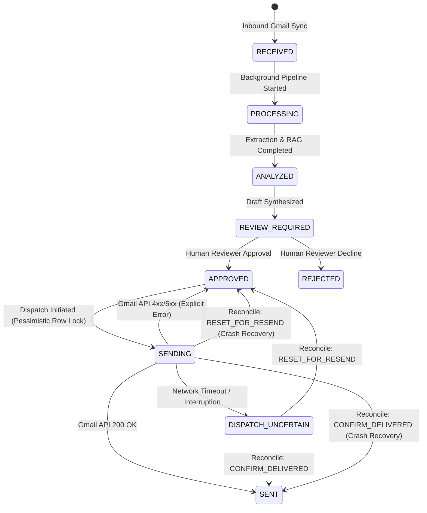

# Lunova — System Architecture Documentation

**Architecture Pattern:** Modular Monolith  
**Primary Tenant:** Lunetron (`company_id: "lunetron"`)  
**Core Pipeline:** Gmail Ingestion $\longrightarrow$ Attachment Parsing $\longrightarrow$ Requirement Extraction $\longrightarrow$ Scoped RAG Retrieval $\longrightarrow$ Proposal Generation $\longrightarrow$ Human Review & Approval $\longrightarrow$ Secure Dispatch

---

## 1. Modular Monolith Architecture

Lunova is structured as a modular monolith to maximize developer velocity, type safety, and transactional consistency while preserving clear domain boundaries:

```
Lunova/
├── backend/
│   ├── app/
│   │   ├── api/routes/          # HTTP controllers (auth, proposals, knowledge, intelligence, integrations)
│   │   ├── auth/                # JWT services, password hashing, and user schemas
│   │   ├── core/                # Database engine, config settings, and Fernet encryption
│   │   ├── models/              # SQLAlchemy 2.0 ORM entities (Proposal, Email, Attachment, Audit, etc.)
│   │   └── platform/services/   # Orchestration (ProposalService, GmailSyncService, GmailSendService)
│   ├── intelligence/            # Domain-isolated AI engine
│   │   ├── document_processing/ # PDF/DOCX/TXT parsers and structural chunkers
│   │   ├── extraction/          # Requirement extraction logic
│   │   ├── retrieval/           # Tenant-isolated knowledge retriever and vector cosine similarity
│   │   ├── generation/          # Grounded proposal draft synthesis
│   │   ├── evaluation/          # Factual grounding and anti-hallucination scoring
│   │   └── providers/           # GeminiProvider, GeminiEmbeddingProvider, and Mock providers
│   └── migrations/              # Alembic schema versioning (001 through 008)
└── frontend/
    ├── app/                     # Next.js 14 App Router pages (Dashboard, Proposals, Knowledge, Settings)
    ├── components/              # UI components, modals, and review stations
    ├── hooks/                   # TanStack Query custom hooks (useProposals, useAuth, useSettings)
    └── services/                # API client with automatic JWT header injection and 401 handling
```

---

## 2. Dispatch State Machine & Concurrency Control

Dispatches adhere to a deterministic, tamper-evident state machine:



### Pessimistic Row Locking (`with_for_update`)
In [`GmailSendService.send_approved_proposal()`](file:///c:/Users/Lokesh/OneDrive/Desktop/Projects/Lunova/backend/app/platform/services/gmail_send_service.py), row locking prevents race conditions:
```python
stmt_p = select(Proposal).filter(
    Proposal.id == proposal_id,
    Proposal.company_id == company_id,
).with_for_update()
proposal = (await db.execute(stmt_p)).scalar_one_or_none()
```
- In PostgreSQL, the first request acquires the exclusive row lock.
- Any concurrent request is blocked until the first transaction commits status `SENDING` or `SENT`.
- When the second transaction executes, status check triggers an immediate conflict error (`Proposal is currently being dispatched`).

---

## 3. Network Timeout Uncertainty & Human Reconciliation

Because SMTP/Gmail API transmission over networks cannot guarantee atomic exactly-once delivery, socket timeouts or connection resets after dispatch initiation are treated as **uncertain outcomes**:
1. Proposal status transitions immediately to `DISPATCH_UNCERTAIN`.
2. Automatic retries are **strictly prohibited** to prevent sending duplicate emails to prospective clients.
3. Resend buttons in the UI are disabled.
4. An authorized reviewer (`ADMIN` or `MEMBER`) must inspect Gmail sent records and invoke the reconciliation endpoint:
   - `CONFIRM_DELIVERED`: Marks status as `SENT` with documented evidence.
   - `RESET_FOR_RESEND`: Returns status to `APPROVED` for a controlled re-attempt.

---

## 4. Knowledge Quarantine Architecture

Synthetic fixture documents under `fixtures/knowledge/lunetron/` contain unverified marketing claims regarding ISO/SOC certifications, 99.99% SLAs, and client case studies.

To ensure synthetic data never leaks into verified production retrieval:
1. **Quarantine Headers:** Every fixture carries `<!-- QUARANTINE_STATUS: BENCHMARK_ONLY -->`.
2. **Ingestion Enforcement:** [`DocumentService.ingest_document()`](file:///c:/Users/Lokesh/OneDrive/Desktop/Projects/Lunova/backend/app/platform/services/document_service.py) inspects all incoming documents and rejects quarantined fixtures with HTTP 400.
3. **Isolated Test Execution:** Automated benchmark tests retain access to fixtures in dedicated test namespaces without contaminating the company's knowledge base.

---

## 5. Vector Dimension Alignment (768 Dimensions)

All vector storage and embedding providers are aligned to **768 dimensions**:
- **Google Gemini Model:** `text-embedding-004` (768 dimensions).
- **Database Schema:** `DocumentChunk.embedding` defined as `Vector(768)` in migration `004_align_vector_dimension_768.py`.
- **Configuration:** `settings.EMBEDDING_DIMENSION = 768`.
- Legacy 1536-dimensional assumptions have been eliminated across backend models, tests, and frontend visualizations.

