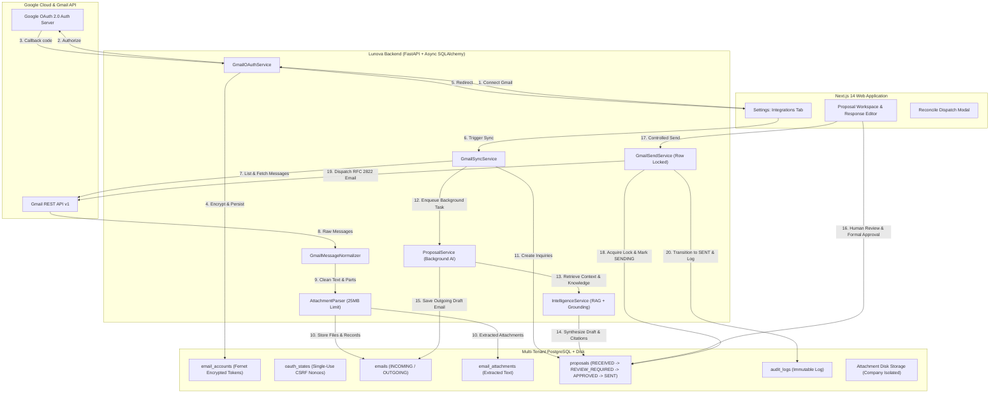

# Lunova — Real Gmail Integration Architecture

## 1. Overview & Architectural Principles

The Lunova Gmail Integration provides an enterprise-grade, secure, multi-tenant email interface for automated RFP ingestion and human-controlled proposal dispatching.

---

## 2. Core Components & Responsibilities

### 2.1 Centralized Token Lifecycle (`GmailOAuthService`)
- **Single Source of Truth**: All token acquisitions throughout synchronization and outbound dispatching flow through `GmailOAuthService.get_valid_access_token(db, account)`.
- **Automatic Refresh with Jitter**: Access tokens expiring within 5 minutes are refreshed proactively against Google's token endpoint.
- **Pessimistic Concurrency Locking**: Token refresh operations acquire row-level locks on `email_accounts` to prevent duplicate refresh races across concurrent worker threads.
- **Revocation Safety**: In case of invalid grants or permanent revocations, accounts are deactivated (`is_active = False`) and logged without exposing raw secrets.

### 2.2 Inbox Ingestion & Normalization (`GmailSyncService` & `GmailMessageNormalizer`)
- **Rate-Limiting & Exponential Backoff**: Built-in exponential backoff in `GmailClient._request_with_retry` automatically retries HTTP 429 and HTTP 503 responses with random jitter.
- **Pagination Support**: `list_messages` and `MockGmailClient` support `page_token` traversal for handling mailboxes with large message batches.
- **Incremental Sync with History Fallback**: Supports Gmail's `history.list` API via `list_history`, falling back to standard inbox synchronization if history tokens expire.
- **Deduplication**: Strict idempotency prevents re-ingestion of previously processed Gmail `message_id` records.
- **Automated Message & Noise Filtering**:
  - Automatically identifies bounce notices (`mailer-daemon@`, `postmaster@`), system notifications (`no-reply@`), and calendar invites (`invitation:`, `accepted:`).
  - Noise emails are preserved for audit records with `proposal_id = None`, preventing spam from entering the proposal workflow.
- **Thread Association**:
  - Incoming messages belonging to an existing thread ID (`thread_id`) are linked directly to the parent `Proposal` rather than generating redundant proposal entries.
- **Safe Attachment Parsing**:
  - Enforces a 25 MB size limit per attachment (`AttachmentParser`).
  - Corrupted, encrypted, or unsupported files are marked with explicit statuses (`OVERSIZED`, `CORRUPTED`, `UNSUPPORTED`) and persist error metadata without halting message ingestion.

### 2.3 AI Orchestration (`ProposalService` + `IntelligenceService`)
- **RAG & Grounding**: Ingested proposal inquiries feed directly into `ProposalContext`, executing vector retrieval against tenant knowledge bases (768-dimension embeddings).
- **Draft Outgoing Email Generation**: The generative intelligence layer produces structured proposal content and synthesizes a draft reply email stored in the `emails` table with `direction = OUTGOING`.
- **Human Review Gate**: Generated proposals transition to `REVIEW_REQUIRED`. Autonomous sending is strictly barred.

### 2.4 Controlled Sending & Uncertainty Reconciliation (`GmailSendService`)
- **Strict Approval Gate**: Outbound sending is only permitted for proposals in `APPROVED` status.
- **Pessimistic Locking & SENDING State**:
  - Row lock (`with_for_update()`) is acquired immediately.
  - State is committed to `SENDING` prior to network dispatch to prevent concurrent duplicate sends.
- **RFC 2822 Formatting & Threading**: Sets `From`, `To`, `Subject`, `In-Reply-To`, and `References` headers to maintain email thread continuity in client mail clients.
- **Timeout Safety & DISPATCH_UNCERTAIN**:
  - If a network timeout or connection reset occurs after message submission, the proposal is marked as `DISPATCH_UNCERTAIN`.
  - Automatic retries are blocked to prevent duplicate email delivery to clients.
  - Reviewers can safely reconcile via `reconcile_dispatch` with mandatory audit notes (`CONFIRM_DELIVERED` or `RESET_FOR_RESEND`).
