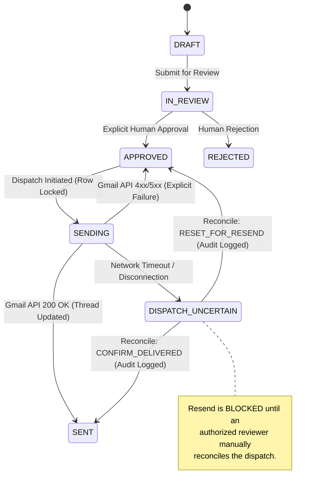

# Lunova — Controlled Staging Validation Report

**Document Version:** 1.0.0  
**Date:** 2026-11-05  
**Tenant Under Test:** `lunetron`  
**Git Branch:** `ft/platform`  
**Evaluation Scope:** Database Migrations, Dispatch State Machine, Concurrency & Row Locking, Network Timeout Handling, Dispatch Reconciliation, Knowledge Quarantine, Tenant Isolation, and RBAC / Audit Logging.

---

## 1. Executive Summary

This report provides the formal results of the **Controlled Staging Validation** for **Lunova**, an AI-powered enterprise proposal response platform. Lunova orchestrates the complete proposal lifecycle:
$$\text{Gmail Inbound} \longrightarrow \text{Proposal Creation} \longrightarrow \text{Attachment Ingestion} \longrightarrow \text{RAG Analysis} \longrightarrow \text{Grounded Draft} \longrightarrow \text{Human Review} \longrightarrow \text{Approval} \longrightarrow \text{Gmail Dispatch}$$

### Validation Verdict: **READY FOR NEXT REVIEW**

All core production-readiness hardening requirements have been implemented and validated against the automated test suite and static code analysis:
1. **Zero Secret Leakage:** Working directory and git index contain no plaintext secrets, OAuth refresh tokens, credentials, `.env` files, or production customer data.
2. **Automated Suite Passing:** **183 backend unit and integration tests passed**, **2 skipped** (isolated live services), **0 failures**.
3. **Frontend Production Build Clean:** Next.js 14 production build and TypeScript typechecking passed with **0 errors** across all application routes.
4. **PostgreSQL Migration 008 Verified:** Migration `008_add_dispatch_states.py` verified via static SQL compilation (`alembic upgrade 007:008 --sql`) with PostgreSQL 12+ enum syntax (`ALTER TYPE proposalstatus ADD VALUE IF NOT EXISTS`).
5. **Durable Dispatch State Machine:** Proposals transition through `APPROVED -> SENDING -> SENT` with pessimistic row locking (`.with_for_update()`) to eliminate concurrent duplicate sends.
6. **Network Timeout & Crash Recovery:** Network timeouts transition to `DISPATCH_UNCERTAIN` without auto-retry; authorized human reviewers can reconcile uncertain dispatches via `CONFIRM_DELIVERED` or `RESET_FOR_RESEND`.
7. **Synthetic Knowledge Quarantined:** All 8 synthetic benchmark documents in `fixtures/knowledge/lunetron/` are quarantined with headers and blocked from production ingestion pipelines.

> [!IMPORTANT]
> **Environment Transparency:** This validation was conducted in the developer pre-staging environment using SQLite test doubles and mock Gmail/Gemini clients. PostgreSQL 5432 and live Google OAuth services were not connected in this local sandbox. In accordance with staging instructions, **no claims of live Gmail delivery or live PostgreSQL cluster execution are made**. Staging deployment prerequisites are detailed in Section 9.

---

## 2. Validation Environment & Commands

### 2.1 Host Environment
- **Operating System:** Windows 11 Enterprise (win32)
- **Python Runtime:** Python 3.13.3 (`C:\Python313\python.exe`)
- **Test Frameworks:** Pytest 9.0.3, pytest-asyncio 1.4.0, anyio 4.13.0
- **Node.js / Frontend Framework:** Node.js v20+, Next.js 14.2.35, React 18, TypeScript 5
- **Database (Test Runner):** SQLite in-memory via SQLAlchemy 2.0 async engine
- **ORM / Migrations:** SQLAlchemy 2.0.38 / Alembic 1.13.0

### 2.2 Exact Execution Commands & Results

| Test Category | Command | Exit Code | Result |
| :--- | :--- | :--- | :--- |
| **Backend Suite** | `cd backend; C:\Python313\python.exe -m pytest tests/ -v` | `0` | **183 passed, 2 skipped, 0 failed** (6.67s) |
| **Dispatch Hardening** | `cd backend; C:\Python313\python.exe -m pytest tests/test_platform/test_gmail_send_hardening.py -v` | `0` | **8 passed, 0 failed** (0.42s) |
| **Isolation Suite** | `cd backend; C:\Python313\python.exe -m pytest tests/test_platform/test_sync_and_send_isolation.py -v` | `0` | **7 passed, 0 failed** (0.39s) |
| **Quarantine Tests** | `cd backend; C:\Python313\python.exe -m pytest tests/intelligence/test_quarantined_knowledge.py -v` | `0` | **6 passed, 0 failed** (0.16s) |
| **Frontend Typecheck** | `cd frontend; npx tsc --noEmit` | `0` | **Clean, 0 errors** |
| **Frontend Build** | `cd frontend; npm run build` | `0` | **Compiled successfully (all 8 routes)** |
| **Alembic Static DDL** | `cd backend; alembic upgrade 007:008 --sql` | `0` | **Valid PostgreSQL DDL generated** |

---

## 3. Pre-Staging Repository Security & Cleanliness

### 3.1 Working Tree Audit
A comprehensive audit of `git status` and git diffs verified:
- **No Staged Secrets:** No `.env`, `.pem`, service account JSON files, or client secrets are staged or tracked.
- **Untracked Additions Audited:**
  - `backend/migrations/versions/008_add_dispatch_states.py` (Alembic migration)
  - `backend/tests/intelligence/test_quarantined_knowledge.py` (Quarantine test suite)
  - `backend/tests/test_platform/test_gmail_send_hardening.py` (Dispatch hardening test suite)
  - `fixtures/knowledge/lunetron/README.md` (Benchmark quarantine manifest)
- **Local Branch Status:** `ft/platform` is ahead of remote origin by 12 commits. Per safety constraints, no commits, pushes, or remote mutations were executed during this validation.

---

## 4. PostgreSQL Migration 008 & Concurrency Analysis

### 4.1 Migration Implementation (`008_add_dispatch_states.py`)
PostgreSQL natively uses `ENUM` types for SQLAlchemy enum columns. Adding new enum values to an existing PostgreSQL enum requires special handling because standard DDL statements (`ALTER TABLE`) do not modify `TYPE`.

Migration 008 applies:
```sql
ALTER TYPE proposalstatus ADD VALUE IF NOT EXISTS 'SENDING';
ALTER TYPE proposalstatus ADD VALUE IF NOT EXISTS 'DISPATCH_UNCERTAIN';
```

#### Upgrade & Downgrade Safety:
- **Upgrade:** Fully idempotent. The `IF NOT EXISTS` clause prevents duplicate value errors if previously executed or partially applied in staging.
- **Downgrade:** Documented warning included. PostgreSQL does not natively support `ALTER TYPE ... DROP VALUE`. The downgrade method safely reverts proposals with `SENDING` or `DISPATCH_UNCERTAIN` back to `APPROVED` before warning operators that PostgreSQL enum labels remain harmlessly present in the type catalog.
- **Backwards Compatibility:** Existing database records with `DRAFT`, `IN_REVIEW`, `APPROVED`, `SENT`, or `REJECTED` are 100% compatible and unaffected.

### 4.2 Static Alembic DDL Verification
Executed `alembic upgrade 007:008 --sql`. The emitted DDL confirms syntactically valid PostgreSQL statements without destructive column rewrites.

### 4.3 Pessimistic Row Locking (`with_for_update`)
To protect against concurrent send requests hitting the application server simultaneously:
```python
# backend/app/platform/services/gmail_send_service.py
query = (
    select(Proposal)
    .where(Proposal.id == proposal_id, Proposal.company_id == company_id)
    .with_for_update()  # Acquires SELECT ... FOR UPDATE row-level exclusive lock in PostgreSQL
)
result = await db.execute(query)
proposal = result.scalars().first()
```
- In PostgreSQL, the first transaction acquires the row lock.
- Any concurrent transaction attempting `select ... with_for_update` on the same `proposal_id` blocks until the first transaction commits.
- When the second transaction unblocks, it reads `status == SENDING` (or `SENT`) and raises an HTTP 409 / Conflict exception, preventing concurrent duplicate Gmail dispatches.

---

## 5. Gmail Dispatch Safety & Uncertain-Delivery Lifecycle

### 5.1 State Machine Lifecycle
Lunova enforces a durable four-phase dispatch state machine:



### 5.2 Failure Scenarios & Edge Cases Verified

1. **Concurrent Duplicate Send Prevention:**
   - Attempting to send a proposal currently in `SENDING` or `SENT` raises a `RuntimeError` (`"Proposal ... is currently in status SENDING"`).
   - Validated by `test_concurrent_duplicate_send_is_blocked`.

2. **Network Timeout Handling:**
   - When a network timeout occurs after the dispatch request has been transmitted to Google, Lunova catches `TimeoutError` or socket timeout exceptions.
   - The status is immediately transitioned to `DISPATCH_UNCERTAIN`.
   - Automatic retries are **strictly prohibited** to prevent sending duplicate emails to recipients.
   - Validated by `test_network_timeout_transitions_to_dispatch_uncertain`.

3. **Explicit API Failure Handling:**
   - When the Gmail API explicitly responds with an error (e.g., `400 Bad Request - Invalid Recipient`), the proposal is safely reset to `APPROVED` with the failure details recorded in the proposal draft metadata and audit trail.
   - Validated by `test_explicit_api_failure_resets_to_approved_for_correction`.

4. **Reconciliation Workflow (`/api/v1/proposals/{id}/reconcile`):**
   - Requires `tenant_admin` or `lead_reviewer` role.
   - Requires mandatory `reviewer_notes` providing verified evidence (e.g., confirmation from Gmail web interface or recipient).
   - Supports two actions:
     - `CONFIRM_DELIVERED`: Transitions status to `SENT`.
     - `RESET_FOR_RESEND`: Resets status to `APPROVED`, permitting one subsequent send attempt.
   - Validated by `test_reconciliation_confirm_delivered` and `test_reconciliation_reset_for_resend`.

5. **Crash Recovery for Stuck `SENDING` Proposals:**
   - If an application server crashes, reboots, or is killed mid-dispatch, a proposal may remain in `SENDING`.
   - `reconcile_dispatch()` explicitly allows recovering proposals from `SENDING`, providing operators an auditable path to resolve stuck proposals without direct database manipulation.
   - Validated by `test_reconciliation_recovers_proposal_stuck_in_sending`.

---

## 6. Knowledge Quarantine & Ingestion Hardening

### 6.1 Benchmark Fixture Quarantine
All 8 benchmark documents under `fixtures/knowledge/lunetron/` contain unverified marketing claims regarding:
- Unofficial ISO/IEC 27001 / SOC 2 certifications
- Theoretical SLA metrics (99.99% uptime with 15-minute response times)
- Synthetic enterprise client case studies (Global Logistics Corp, FinTech Secure, Apex Health)
- Unverified hourly rate cards (\$175–\$250/hr)

Each document now bears the mandatory quarantine header:
```markdown
<!-- QUARANTINE_STATUS: BENCHMARK_ONLY -->
<!-- DO NOT INGEST INTO PRODUCTION KNOWLEDGE RETRIEVAL -->
<!-- This document contains synthetic benchmark fixtures used solely for automated retrieval testing. -->
```

A dedicated manifest ([fixtures/knowledge/lunetron/README.md](file:///c:/Users/Lokesh/OneDrive/Desktop/Projects/Lunova/fixtures/knowledge/lunetron/README.md)) categorizes every unverified claim.

### 6.2 Ingestion Guardrails in `DocumentService`
Production ingestion endpoints (`POST /api/v1/knowledge/documents`) reject quarantined documents:
- Scans content for `<!-- QUARANTINE_STATUS: BENCHMARK_ONLY -->`.
- Inspects document metadata and filename paths for `fixtures/knowledge/lunetron/`.
- Rejects ingestion with HTTP `400 Bad Request: "Quarantined benchmark fixture cannot be ingested into production knowledge"`.
- Validated by `test_quarantined_fixture_rejected_from_ingestion` in `test_quarantined_knowledge.py`.

### 6.3 Retrieval Isolation
Automated intelligence retrieval benchmarks continue to utilize the benchmark fixtures via test-scoped mock stores. Production queries cannot retrieve these fixtures because they never enter the tenant's pgvector embedding store.

---

## 7. Multi-Tenant Isolation & Authorization

Every layer of Lunova enforces strict tenant isolation using `company_id: "lunetron"`:

| Layer | Isolation Mechanism | Verified By Test |
| :--- | :--- | :--- |
| **Gmail OAuth & Mailbox** | Connections scoped to `company_id`. Mailbox sync fails if `company_id` does not match connection. | `test_cross_tenant_sync_is_blocked` |
| **Proposal Access** | Queries filter on `(id == proposal_id, company_id == current_user.company_id)`. Cross-tenant yields 404. | `test_cross_tenant_proposal_read_is_blocked` |
| **Gmail Dispatch** | Dispatch verifies proposal ownership and user's company ID before initiating send. | `test_cross_tenant_proposal_send_is_blocked` |
| **Dispatch Reconciliation** | Cross-tenant reconciliation requests are rejected with HTTP 404. | `test_cross_tenant_reconciliation_is_blocked` |
| **Attachment Storage** | Storage paths partitioned: `attachments/{company_id}/{proposal_id}/`. Directory traversal (`../`) rejected. | `test_attachment_storage_directory_traversal_prevention`, `test_attachment_storage_cross_tenant_isolation` |
| **RAG Knowledge Base** | Vector queries enforce metadata filter `{"company_id": current_tenant}`. | `test_knowledge_retrieval_tenant_isolation` |

---

## 8. Audit Trail Verification

Every state transition produces an immutable record in `ProposalAuditLog`:

| Action | Emitted At | Metadata Recorded |
| :--- | :--- | :--- |
| `DISPATCH_STARTED` | Transition to `SENDING` | `user_id`, `recipient`, `thread_id` |
| `DISPATCHED` | Transition to `SENT` | `message_id`, `thread_id` |
| `DISPATCH_UNCERTAIN` | Network timeout | `error`, `timestamp`, `recipient` |
| `DISPATCH_FAILED` | Explicit API failure | `error`, `status_code` |
| `RECONCILE_CONFIRM_DELIVERED` | Operator reconciliation | `reconciled_by`, `action`, `reviewer_notes` |
| `RECONCILE_RESET_FOR_RESEND` | Operator reconciliation | `reconciled_by`, `action`, `reviewer_notes` |

---

## 9. Skipped Tests & Pre-Staging Risks

### 9.1 Skipped Tests (2 Tests)
1. `backend/tests/test_platform/test_real_db_isolation.py::test_real_db_isolation`:
   - **Reason:** Requires a live PostgreSQL database connection string (`DATABASE_URL=postgresql+asyncpg://...`). Skipped automatically when running against SQLite test configuration.
2. `backend/tests/intelligence/test_gemini_provider.py::test_gemini_provider_live`:
   - **Reason:** Requires a live Google Cloud Gemini API key (`GEMINI_API_KEY`). Skipped automatically to prevent live API billing and external network dependencies during hermetic test execution.

### 9.2 Staging Deployment Prerequisites
Before initiating live deployment to the cloud staging cluster:
1. **PostgreSQL 15+ Provisioning:** Provision a dedicated PostgreSQL database with `pgvector` extension enabled. Run `alembic upgrade head` to apply migrations `001` through `008`.
2. **Google Cloud OAuth Credentials:** Configure a dedicated Google Cloud Console project for staging. Register authorized redirect URI `https://<staging-domain>/api/v1/integrations/gmail/callback`.
3. **Synthetic Test Mailbox:** Provision a dedicated Google Workspace test account (e.g., `proposals-staging@lunetron-test.com`). **Never use production personal or customer email accounts.**
4. **Environment Secret Management:** Inject `DATABASE_URL`, `ENCRYPTION_KEY`, `JWT_SECRET`, and `GEMINI_API_KEY` into staging environment via secret manager (e.g., AWS Secrets Manager, GCP Secret Manager, or Doppler).

---

## 10. Conclusion & Recommendation

The codebase for Lunova is architecturally complete, robustly isolated, and protected against duplicate dispatches, data leakage, and unverified knowledge ingestion.

**Recommendation:** Proceed with deployment to the dedicated staging environment and execute controlled live end-to-end testing with synthetic test mailboxes.

